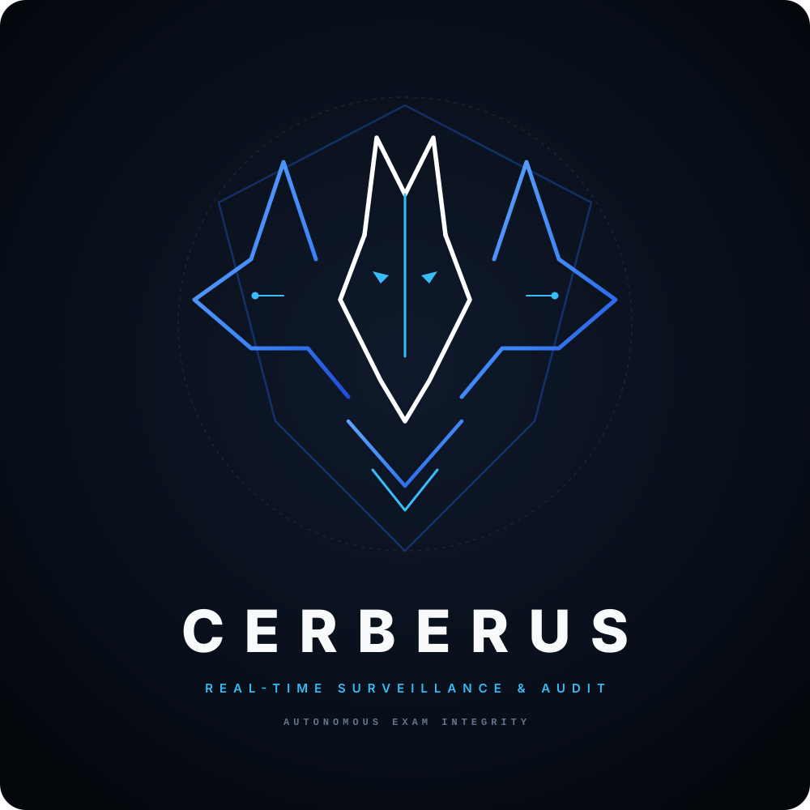

<p align="center">
  
</p>

AI-assisted exam proctoring dashboard. CERBERUS watches one or more camera feeds, uses YOLO11 pose and object models to flag suspicious behaviour, records every session, and gives a reviewer a timeline to check each flag against the recording.

It flags three things:

| Rule | What it catches |
|------|-----------------|
| **Phone** | A cell phone in a student's hand or on the desk (also flags some calculators) |
| **Reach** | A hand-off between neighbouring students, such as a passed note |
| **Gaze** | A prolonged sideways head turn |

> **CERBERUS flags, it does not judge.** Every flag is a prompt for a human reviewer, who can dismiss false positives without deleting the evidence. Only use it where students have been told they are being recorded and your institution's policies allow it.

---

## Features

- **Live monitoring dashboard** with a camera grid, live counters, an audit log, and an evidence gallery you can filter by flag type
- **Multiple cameras**: local webcams, IP/RTSP streams (for example a phone), and video files that loop for demos. Cameras are added from the dashboard without a restart
- **Per-exam sessions**: each exam gets its own recordings and incidents, so two exams on the same day never mix
- **Per-account session ownership**: every session belongs to the account that created it, and other accounts cannot see it.
- **Recording in 5-minute files**: each camera saves to `recordings/<session>/<camera>/` at 10 fps and at most 960 px wide, and evidence images go to `static/violations/<session>/<camera>/`. A crash costs at most one file
- **Incident grouping**: repeats of the same flag on the same student within 10 seconds are one incident, and students flagged at the same moment each get their own
- **Review page**: play an incident from 5 seconds before the alert, jump around on an incident timeline, pick between recordings, filter active or dismissed flags, and dismiss false positives
- **Multi-camera grouping**: the same violation seen by several cameras within 5 seconds shows as one card with a camera picker (display only; nothing is merged or deleted)
- **Live rule toggles**: switch phone, reach, or gaze detection on or off per exam, for example when calculators are allowed
- **Accounts and MFA**: username and password sign-up, optional authenticator-app (TOTP) MFA, and MFA-gated session deletion
- **Crash recovery**: recordings left half-written by a crash or power loss are finalised on the next start (a file cut off mid-write may still not play)

---

## Requirements

- Python 3.9+
- A webcam, IP camera, or video file to test with
- The YOLO weights `yolo11n-pose.pt` and `yolo11n.pt`. Ultralytics downloads them on first run unless you place them next to `app.py`, so the first run needs internet access
- **Recommended:** `ffmpeg` on your PATH. Without it, some recordings may not play in the browser

## Installation

```bash
git clone <your-repo-url> cerberus
cd cerberus

python -m venv .venv
source .venv/bin/activate        # Windows: .venv\Scripts\activate

pip install flask opencv-python ultralytics numpy lapx
```

## Running

```bash
python app.py
```

Then open <http://127.0.0.1:5000>. The console prints the build ID on startup. Create your first account at `/signup`.

### Configuration

| Environment variable | Purpose | Default |
|----------------------|---------|---------|
| `CERBERUS_SECRET_KEY` | Flask session key. Set it to stay signed in across restarts | Random key each run (everyone is signed out on restart) |
| `CERBERUS_HOST` | Interface to listen on. Use `0.0.0.0` to reach the dashboard from other devices | `127.0.0.1` |


> **Sign-up is open.** Anyone who can reach the login page can create an account. The default `127.0.0.1` setting keeps that to your own machine. If you set `CERBERUS_HOST=0.0.0.0`, only do so on a network you trust.

---

## Recommended setup

These figures follow from how the detection geometry works. They are starting points, not guarantees, so confirm them in a test session.

- **Camera:** 2-2.5 m high at the front of the room, facing the students and tilted slightly down, so every face and both shoulders are visible and rows separate in the image.
- **Range:** keep the farthest row within about 4-5 m of a camera. Beyond that, shoulders are too small in the frame for reliable head-turn and wrist tracking. Cover larger rooms with several cameras, each watching a block of roughly 3 rows by 4 seats.
- **Seating:** about 1 m between students sideways and about 1.2 m between rows. Tighter spacing makes a hand-off harder to tell apart from an ordinary arm position.
- **Start-up:** press ARM only when everyone is seated and facing forward, and wait for the on-screen "CALIBRATING" labels to clear before the exam begins.

---

## Using CERBERUS

1. **Sign up** at `/signup` with a username (3-32 characters: letters, numbers, `_ . -`) and a password (8+ characters). You can enable authenticator MFA at the same time, or later at `/security/mfa`.
2. On the **Sessions** page (/), name a new session and start it, or open one of your existing sessions.
3. On the **Monitor** page (`/monitor`):
   - Camera 0 is registered by default.
   - Click **Use** on a camera tile to start it.
   - Choose which **Detection Rules** apply to this exam.
   - Click **ARM MONITORING** to start flagging, and **PAUSE SYSTEM** to stop. Recordings are finalised on pause.
   - Click **RECALIBRATE** if students change seats. It restarts every student's calibration without cutting the recording.
4. Open **Review Recordings** (`/review`) to go through flags, watch the footage, and dismiss false positives. Dismissing cannot be undone.

### Accounts and session ownership

- Another account that asks for your session, recording, incident, or evidence image gets a 404.
- There is one live session for the whole app. Another account can take over the live controls by creating its own session, which is only possible while monitoring is paused.
- Session names are unique across accounts.
- When upgrading from a build without ownership, existing sessions go to the first account created.

### Deleting data

Deletion is deliberately hard to do by accident:

- **Delete a session** (Sessions page): monitoring must be paused for the active session, you must have MFA enabled, and you must enter an authenticator code and type the exact session name.
- **Reset session** (Monitor page): monitoring must be paused, and you must type `DELETE ALL DATA` and enter an authenticator code. A fresh session, owned by you, is created afterwards.

Both remove the session's database rows, recordings, and evidence images, and cannot be undone.

> **Keep your MFA setup key somewhere safe.** Once MFA is on, sign-in needs an authenticator code, and there are no backup codes. If you lose the device, you are locked out of that account.

---

## How detection works

### Phone
- Every frame, YOLO11n looks for COCO class 67 (cell phone) at confidence above 0.45.
- A second **wrist-crop pass** runs about 3 times a second: it crops a zoomed window around each wrist and re-checks it, which catches small phones held in a hand. A phone is confirmed after 3 hits within 2 seconds, and it must be close to the wrist.
- A **static-object filter** drops "phones" that never move (seat-number plates, furniture): 10 seconds for full-frame detections unless a hand is near, and 6 seconds for wrist-crop detections.
- A **size filter** ignores boxes that are very small or long and thin compared with the student's shoulder width (typically a pen), and small boxes need at least 0.70 confidence.

### Gaze
- Head turn is estimated from how far the nose sits sideways from the shoulder line, relative to shoulder width.
- Each student gets a personal baseline from a 2-second calibration, and it adapts slowly if they settle into a new position.
- A turn must pass 0.55 and last 2.5 seconds to be flagged. Looking down at a paper is excused unless the turn is very strong.
- A held posture (flagged for 8 seconds) is treated as the new normal and re-baselined. When the student returns close to their original position, the original baseline is restored, so turning back to their seat is not flagged as a turn the other way.
- If most students turn at once, CERBERUS assumes the camera was bumped and recalibrates everyone.

### Reach (note passing)
A hand-off is detected when either test passes for 1 second:
- **Zone**: a wrist enters a circle around the neighbour's shoulders, while the hand is held away from its own owner and is closer to the neighbour than to them. A hand resting on its own desk does not count.
- **Extension**: the arm is stretched out and the wrist has travelled toward the neighbour, which catches a paper passed across an aisle.

Only students who are side by side, in the same row, and at a similar depth are paired, so someone reaching past a student in front or behind is not flagged. One hand-off between two students is logged as a single incident. Duplicate ("ghost") skeletons are filtered out, and per-student state survives short tracking drops.

> All thresholds are hand-calibrated, not learned. Test with people seated at real exam spacing and tune the constants at the top of `app.py` before relying on it. Setting `DEBUG_OVERLAY = True` draws yaw and pitch numbers beside each student, and a grey box with the shoulder confidences around anyone the model found but could not track. Pose detection runs at `POSE_IMGSZ = 960` with a low confidence cutoff (`POSE_CONF = 0.25`) so back-row students are picked up. Lower `POSE_IMGSZ` to 640 for more frame rate.

---

## Known limitations

- Subtle phone use is still easy to miss, and a phone under a desk or in a lap may not be seen.
- Reach and gaze use 2D geometry from one camera angle, so overlapping students at different depths can confuse them.
- Matching a phone to a student is a best-effort nearest-shoulder guess, not verified possession.
- Calculators can be flagged as phones, so use the Phone rule toggle.
- Small objects in the back rows of a large room are only a few pixels wide and will be missed.
- Only one live session runs at a time, shared by the whole app.
- Video lag on weaker machines. Run on a GPU or lower the number of cameras for large rooms.